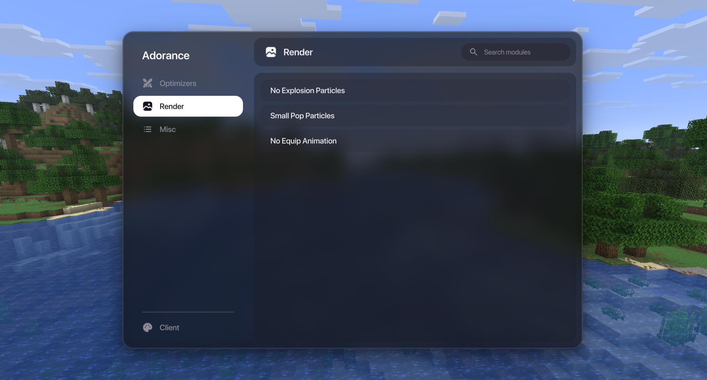

# Adorance
Adorance is a small minecraft client for crystal pvp build for the version 1.21.11.
It is **NOT** build to create an unfair advantage these modules are purely qol.

## License & AI policy
- Feel free to fork, modify, build upon, or use this client as a base for your own please just credit me. This falls under the **MIT License**.
- AI was used as a tool to assist the creation of this project yet this project is **not** vibecoded. Please do not open up pull requests with completly AI written code you do not understand yourself.

## Credits
- The module Hero's anchor optimizer is obviously build and based on the origanal mod by HerobaneNair of which you can find the source [here](https://github.com/HerobaneNair/herosanchoroptimizer).

##Preview

